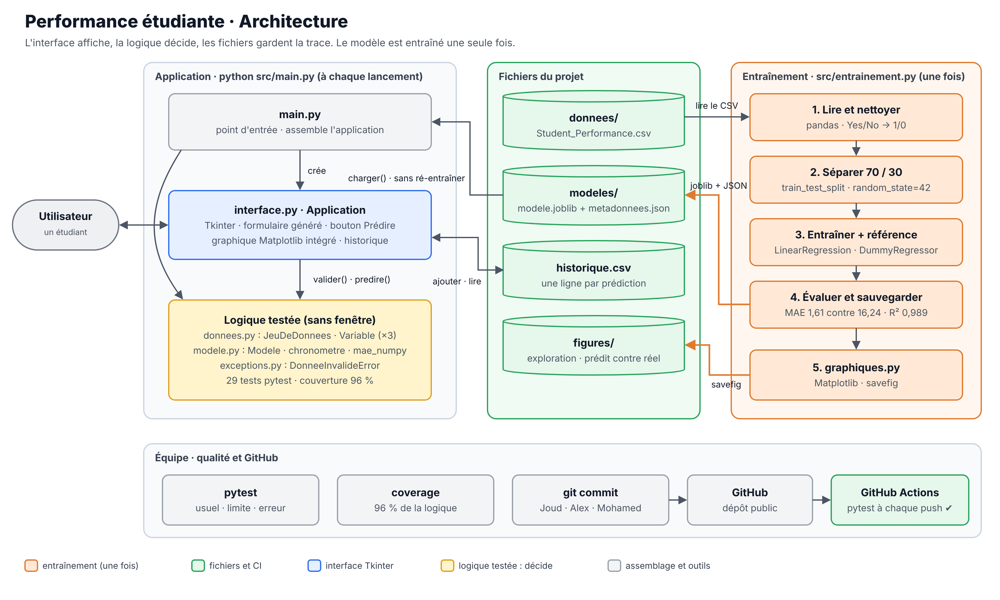
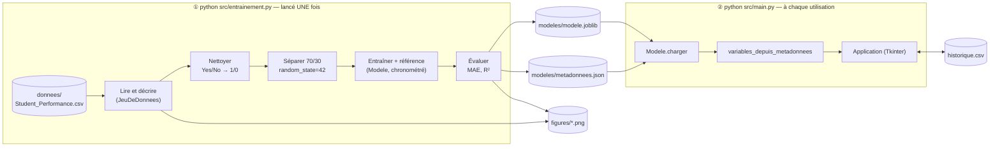
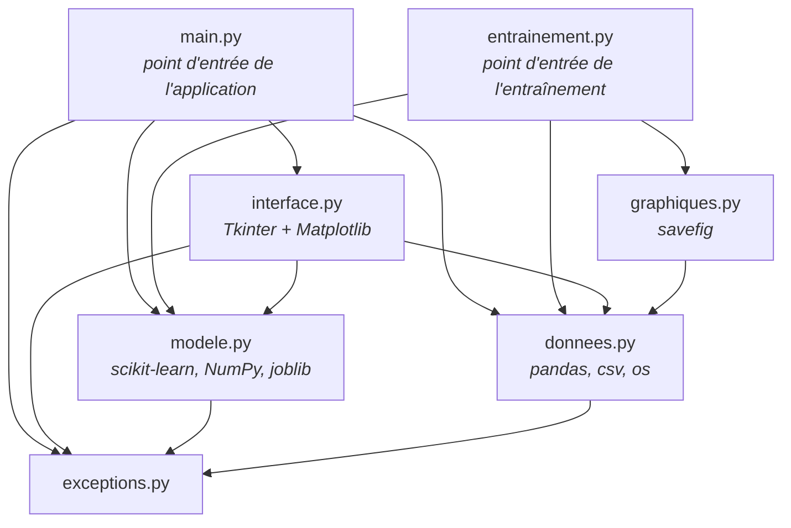
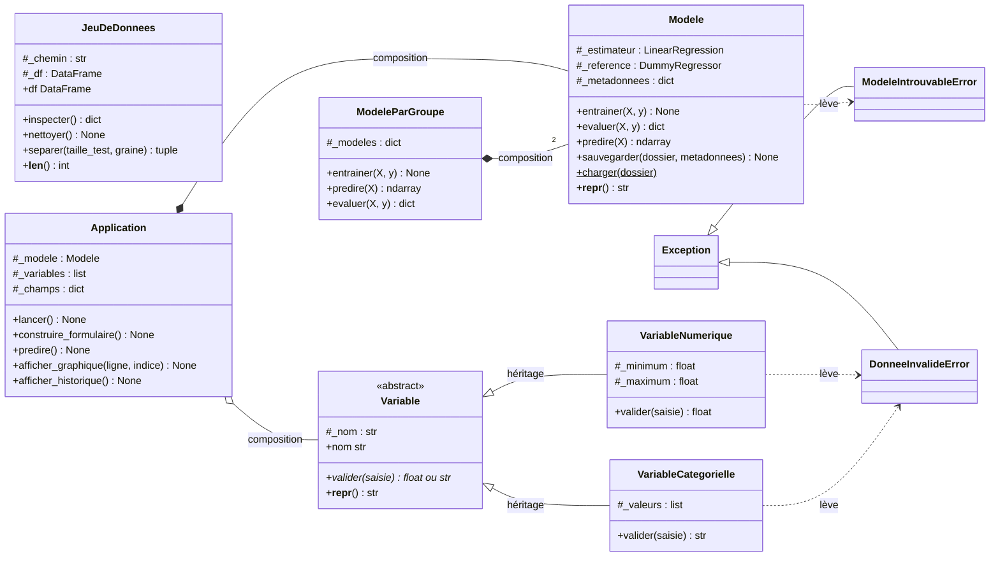
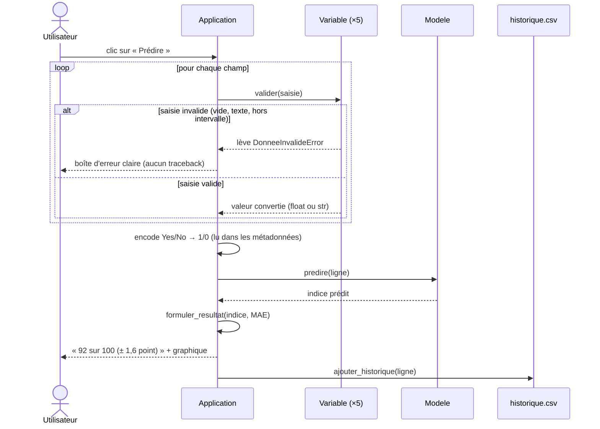
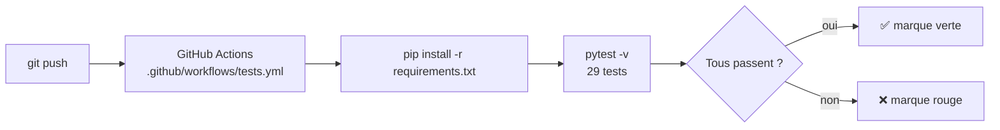

# Architecture du projet

Ce document décrit comment le projet est organisé : les deux programmes, les modules, les classes, le parcours d'une prédiction et les fichiers échangés.

**Principe directeur** (énoncé, ch. 8) : *l'interface appelle la logique, elle ne la contient pas*. Toute la logique (données, modèle, validation) est dans des modules testables sans fenêtre ; `interface.py` ne fait qu'afficher et relayer.



*Schéma modifiable : [docs/architecture.svg](docs/architecture.svg).*

---

## 1. Vue d'ensemble : deux programmes

Le projet contient deux points d'entrée qui ne tournent jamais en même temps.



| Programme | Rôle | Produit |
|---|---|---|
| `src/entrainement.py` | Explore, entraîne, évalue et sauvegarde le modèle | `modeles/modele.joblib`, `modeles/metadonnees.json`, `figures/exploration.png`, `figures/predit_contre_reel.png` |
| `src/main.py` | Recharge le modèle **sans le ré-entraîner** et ouvre l'interface | `historique.csv` (une ligne par prédiction) |

---

## 2. Modules et dépendances

7 modules dans `src/`. Une flèche `A --> B` signifie « A importe B ». Il n'y a aucune dépendance circulaire, et aucun module de logique n'importe `interface.py`.



| Module | Responsabilité | Contenu principal |
|---|---|---|
| `donnees.py` | Tout ce qui touche aux données | Chemins (`os.path.join`), `JeuDeDonnees`, classes `Variable`, historique CSV, métadonnées |
| `modele.py` | Tout ce qui touche au modèle | `Modele`, `ModeleParGroupe`, `chronometre`, `mae_numpy`, `formuler_resultat` |
| `exceptions.py` | Erreurs propres au projet | `DonneeInvalideError`, `ModeleIntrouvableError` |
| `graphiques.py` | Figures enregistrées sur disque | `graphique_exploration`, `graphique_predit_reel` |
| `interface.py` | Affichage uniquement | `Application` |
| `entrainement.py` | Enchaîne les étapes de l'entraînement | `entrainer_et_sauvegarder` |
| `main.py` | Assemble et lance l'application | `main` |

---

## 3. Classes



| Notion (ch. 9 à 11) | Où dans le code |
|---|---|
| **Héritage** | `Variable` (classe abstraite, `ABC`) → `VariableNumerique`, `VariableCategorielle` |
| **Polymorphisme** | `valider()` est redéfinie dans les deux enfants : l'interface appelle `variable.valider(saisie)` sans connaître le type |
| **Composition** | `Application` contient un `Modele` et une liste de `Variable` ; `ModeleParGroupe` contient 2 `Modele` |
| **Encapsulation** | Attributs protégés (`_nom`, `_df`, `_estimateur`…) lus par des propriétés (`nom`, `df`, `metadonnees`) |
| **Méthodes spéciales** | `__repr__` (`Variable`, `Modele`, `ModeleParGroupe`), `__len__` (`JeuDeDonnees`) |
| **Exceptions personnalisées** | `DonneeInvalideError` et `ModeleIntrouvableError` héritent d'`Exception` |

---

## 4. Parcours d'une prédiction

Ce qui se passe quand l'utilisateur clique sur **Prédire**.



---

## 5. Fichiers de données échangés

| Fichier | Écrit par | Lu par | Format |
|---|---|---|---|
| `donnees/Student_Performance.csv` | — (source Kaggle) | `JeuDeDonnees` | CSV, 10 000 lignes |
| `modeles/modele.joblib` | `Modele.sauvegarder` | `Modele.charger` | Modèle scikit-learn (`joblib`) |
| `modeles/metadonnees.json` | `entrainer_et_sauvegarder` | `Modele.charger`, `variables_depuis_metadonnees` | JSON |
| `historique.csv` | `ajouter_historique` | `lire_historique` | CSV, une ligne par prédiction |
| `figures/*.png` | `graphiques.py` (`savefig`) | — (présentation) | PNG |

Les fichiers de `modeles/` et `historique.csv` sont **générés** : ils ne sont pas versionnés dans Git (voir `.gitignore`).

**Exemple de `metadonnees.json`** (abrégé) : c'est lui qui permet à l'interface de se construire sans rien coder en dur.

```json
{
  "colonnes": ["Hours Studied", "Previous Scores", "Extracurricular Activities",
               "Sleep Hours", "Sample Question Papers Practiced"],
  "numeriques": {"Hours Studied": [1.0, 9.0], "Previous Scores": [40.0, 99.0], "...": "..."},
  "categorielles": {"Extracurricular Activities": ["No", "Yes"]},
  "encodage": {"Extracurricular Activities": {"Yes": 1, "No": 0}},
  "metriques": {"mae": 1.609, "r2": 0.989, "mae_reference": 16.2355, "r2_reference": -0.0009},
  "duree_entrainement_s": 0.0202
}
```

---

## 6. Tests et intégration continue



| Fichier de tests | Ce qui est testé |
|---|---|
| `tests/test_donnees.py` | Lecture et inspection du CSV, nettoyage, séparation, validation des variables (valide, vide, texte, hors intervalle, virgule, bornes exactes), historique, métadonnées |
| `tests/test_modele.py` | `mae_numpy` contre scikit-learn, modèle meilleur que la référence, modèle par groupe, sauvegarde puis chargement, dossier vide, décorateur, script d'entraînement complet, message de résultat |

Couverture de la logique (`src/` hors `interface.py` et `main.py`) : **96 %**.

---

## 7. Correspondance avec les exigences de l'énoncé (§5)

| Chapitre | Exigence | Où |
|---|---|---|
| Ch. 5 | CSV, JSON, chemins `os`, `with`, existence vérifiée | `donnees.py` (chemins, historique), `modele.py` (`sauvegarder`, `charger`) |
| Ch. 6 | Fonctions courtes, docstrings, annotations, `return` | Tous les modules de `src/` |
| Ch. 7 | ≥ 4 modules + `main.py` ; outil du chapitre | 7 modules ; décorateur `chronometre`, `lambda` dans `decrire_variables` |
| Ch. 8 | Exceptions précises, exception personnalisée, ≥ 8 tests, couverture, CI | `exceptions.py`, 29 tests, `.coveragerc`, `tests.yml` |
| Ch. 9–11 | ≥ 3 classes, héritage, polymorphisme, composition, méthode spéciale | Voir la section 3 |
| Ch. 12 | Calcul vectorisé NumPy | `mae_numpy` (sans boucle), comparée à scikit-learn dans un test |
| Ch. 13 | 2 graphiques, documentation citée, journal d'IA | `graphiques.py` + graphique de l'interface, README, `JOURNAL_IA.md` |
