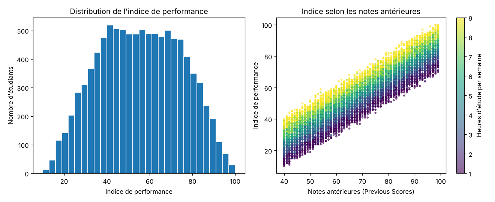
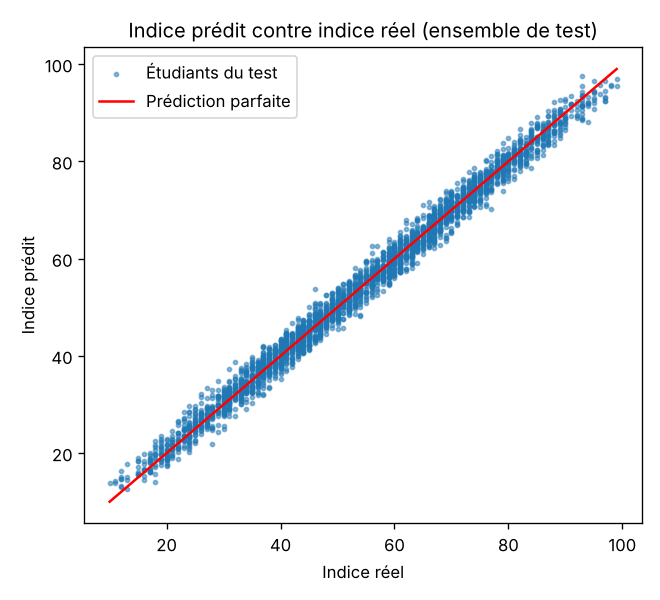
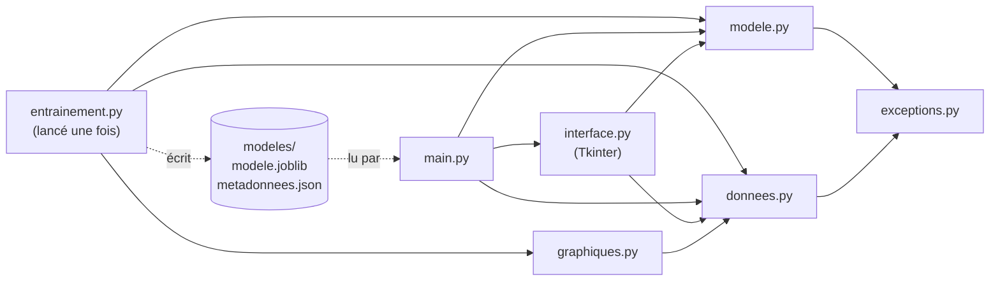
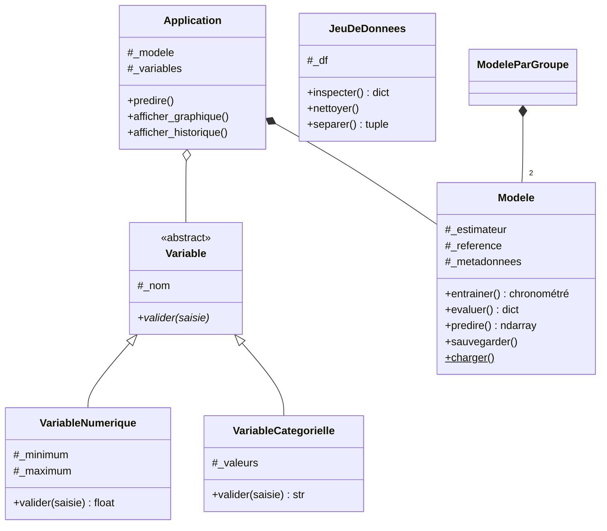
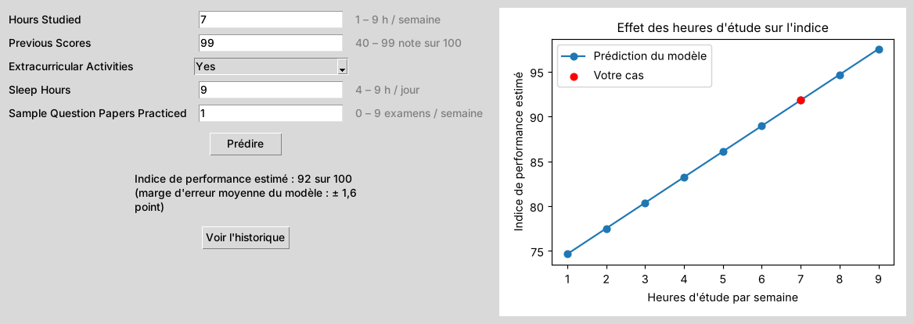

# Présentation — Prédire la performance d'un étudiant

> 5 min d'exposé + 5 min de questions · démo en direct · sans diapositives : ce document sert d'aide-mémoire.
> **Avant de commencer :** `python src/entrainement.py` déjà lancé, application ouverte (`python src/main.py`), captures du plan B prêtes.

## Plan minuté

| Minutage | Partie | Qui |
|---|---|---|
| 0:00 – 0:45 | [1. Problème et données](#1-problème-et-données-000--045) | Joud |
| 0:45 – 1:45 | [2. Modèle](#2-modèle-045--145) | Alex |
| 1:45 – 3:15 | [3. Démo en direct](#3-démo-en-direct-145--315) | Mohamed |
| 3:15 – 4:15 | [4. Conception](#4-conception-315--415) | Joud |
| 4:15 – 5:00 | [5. Bilan](#5-bilan-415--500) | Alex |

Temps de parole : Joud 1 min 45 · Alex 1 min 45 · Mohamed 1 min 30. Mohamed répond en priorité aux questions sur l'interface.

---

## 1. Problème et données (0:00 – 0:45) · Joud

- **Domaine :** l'éducation, un sujet qui nous concerne comme étudiants.
- **Ce que fait l'application :** un étudiant saisit ses habitudes et obtient une estimation de son *indice de performance* (10 à 100), avec un graphique qui montre l'effet d'une heure d'étude de plus.
- **Jeu de données :** *Student Performance* (Kaggle), licence libre de partage.
  - 10 000 lignes, 5 caractéristiques : 4 numériques (heures d'étude, notes antérieures, heures de sommeil, examens pratiqués) et 1 catégorielle (activités parascolaires Oui/Non).
  - 0 valeur manquante, 127 doublons conservés (justifié dans `DECISIONS.md`).
- **Pourquoi celui-là :** cible numérique claire et données propres. CarDekho, envisagé, avait des nombres stockés en texte avec leurs unités : trop de nettoyage pour 8 h.

## 2. Modèle (0:45 – 1:45) · Alex

- **Cible :** `Performance Index` → **régression**.
- **Modèle :** régression linéaire multiple : simple, et la relation est presque linéaire (graphique ci-dessus).
- **Métrique :** **MAE**, lisible en points : « le modèle se trompe en moyenne de X points ». R² en complément.
- **Séparation :** 70 % entraînement / 30 % test, `random_state=42`.

| Modèle (3 000 lignes de test) | MAE | R² |
|---|---|---|
| Référence : toujours la moyenne | 16,24 | 0,00 |
| **Régression linéaire** | **1,61** | **0,989** |
| Une régression par groupe d'activité | 1,61 | 0,989 → aucun gain, on garde le plus simple |

- **Limites :**
  - un R² de 0,989 est suspect : le jeu semble **synthétique**, donc le modèle ne vaut pas pour de vrais étudiants ;
  - les saisies sont bornées aux valeurs observées pour éviter d'extrapoler ;
  - certains doublons peuvent se trouver à la fois dans l'entraînement et dans le test (1,3 %).

## 3. Démo en direct (1:45 – 3:15) · Mohamed

| # | Action | Ce qu'on montre |
|---|---|---|
| 1 | Saisir 7 · 99 · Yes · 9 · 1, puis **Prédire** | « 92 sur 100 (± 1,6 point) » en langage simple |
| 2 | Commenter le graphique | Courbe selon les heures d'étude, notre cas en rouge |
| 3 | Mettre « abc » dans *Previous Scores* | Message clair, **aucun plantage** |
| 4 | Mettre 15 dans *Hours Studied* | « doit être entre 1.0 et 9.0 » (bornes lues dans le JSON) |
| 5 | Saisir « 3,5 » heures et *No* | Virgule acceptée → 81 sur 100 |
| 6 | **Voir l'historique** | Les prédictions sont enregistrées dans `historique.csv` |

## 4. Conception (3:15 – 4:15) · Joud

> Version détaillée : [ARCHITECTURE.md](ARCHITECTURE.md) (parcours d'une prédiction, fichiers échangés, correspondance avec l'énoncé).

**Modules** : l'interface appelle la logique, elle ne la contient pas.

**Classes** : héritage, polymorphisme et composition.

**Choix défendu : l'interface se construit à partir des métadonnées JSON.**
- `entrainement.py` entraîne le modèle **une seule fois** et enregistre ses colonnes, ses bornes et ses catégories.
- `main.py` recharge le modèle et crée une `Variable` par colonne, et chaque `Variable` valide sa saisie à sa façon (polymorphisme).
- Résultat : changer de jeu de données ne demande aucune modification de l'interface, et toute la logique reste testable sans fenêtre.

## 5. Bilan (4:15 – 5:00) · Alex

- **Difficultés :**
  - bugs trouvés tard : `X(...)` au lieu de `X[...]`, et `charger` qui écrasait le modèle par les métadonnées ;
  - conflits de fusion Git ;
  - décision sur les doublons.
- **À refaire autrement :**
  - commits plus réguliers et mieux répartis ;
  - lancer `pytest` avant chaque push ;
  - libellés de l'interface en français.
- **Rôle de l'IA :**
  - 15 entrées dans `JOURNAL_IA.md` ;
  - utilisée pour l'analyse, les corrections et la finition ;
  - 2 vérifications nous ont fait changer d'avis : garder les doublons, et un seul modèle au lieu de deux ;
  - chaque réponse a été vérifiée par un test, une exécution ou la documentation.

---

## Plan B (si la démo échoue)

| Étape de la démo | Capture |
|---|---|
| Accueil | [1_accueil.png](docs/captures/1_accueil.png) |
| Cas normal + graphique | [2_cas_normal.png](docs/captures/2_cas_normal.png) |
| Champ vide | [3_vide.png](docs/captures/3_vide.png) |
| Texte au lieu d'un nombre | [4_texte.png](docs/captures/4_texte.png) |
| Hors intervalle | [5_hors_intervalle.png](docs/captures/5_hors_intervalle.png) |
| Virgule décimale | [6_virgule.png](docs/captures/6_virgule.png) |
| Historique | [7_historique.png](docs/captures/7_historique.png) |

## Questions probables

| Question | Réponse courte | Qui |
|---|---|---|
| Pourquoi la MAE plutôt que le RMSE ? | Elle se lit directement en points d'indice et pénalise moins les rares grosses erreurs. | Alex |
| Pourquoi un R² aussi élevé ? | Le jeu semble généré par une formule presque linéaire : c'est une limite, pas un exploit. | Alex |
| Pourquoi une référence ? | Sans elle, 1,61 ne veut rien dire ; prédire la moyenne donne 16,24. | Alex |
| Comment la MAE est-elle calculée avec NumPy ? | `np.mean(np.abs(y_vrai - y_predit))`, sans boucle ; un test la compare à scikit-learn. | Alex |
| Pourquoi garder les doublons ? | 64 800 combinaisons seulement : environ 730 répétitions sont attendues par hasard, 792 sont observées. | Joud |
| Pourquoi `random_state=42` ? | Pour que la séparation, et donc les résultats, soient reproductibles. | Joud |
| Que fait le décorateur `chronometre` ? | Il enveloppe `entrainer`, mesure la durée avec `time.perf_counter` et la garde dans `derniere_duree`. | Joud |
| Pourquoi une classe `Variable` abstraite ? | Chaque type valide sa saisie à sa façon : l'interface appelle `valider` sans connaître le type. | Joud |
| Que se passe-t-il avec une saisie invalide ? | `valider` lève `DonneeInvalideError`, l'interface l'attrape et affiche un message. | Mohamed |
| D'où viennent les bornes des champs ? | De `metadonnees.json`, écrit pendant l'entraînement. | Mohamed |
| Comment le graphique est-il intégré ? | `FigureCanvasTkAgg` place une `Figure` Matplotlib dans la fenêtre Tkinter. | Mohamed |
| Le modèle est-il ré-entraîné au lancement ? | Non : `main.py` appelle `Modele.charger` (fichier `joblib`). | Mohamed |

## Qui a fait quoi (d'après l'historique Git)

| Membre | Contribution principale |
|---|---|
| **Joud Katbe** | Mise en place (structure, CI), `JeuDeDonnees`, classes `Variable`, historique, `entrainer` / `evaluer` / `mae_numpy`, tests des données, DECISIONS et journal d'IA |
| **Alex Le** | `sauvegarder` / `charger`, `ModeleParGroupe`, tests du modèle |
| **Mohamed Dahmani** | Interface Tkinter : formulaire, bouton Prédire, validation à l'écran, graphique intégré, historique |
| **IA (Claude), déclarée** | Corrections de bugs, `entrainement.py`, `graphiques.py`, `chronometre`, chargement par métadonnées, docstrings, rédaction de la documentation (voir `JOURNAL_IA.md`) |
